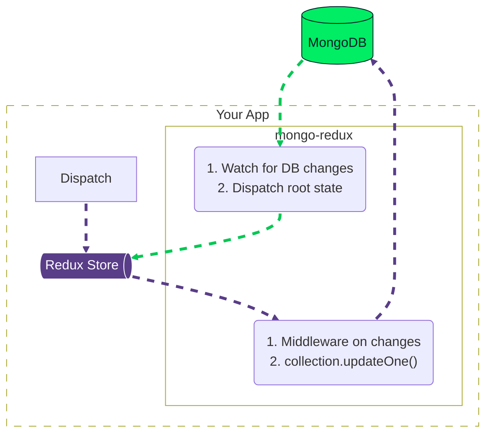

## Mongo-Redux syncer

Synchronize one Redux root state with one MongoDB document.

### Installation

```sh
bun add @tt-tt/mongo-redux
```

This package runs directly from its TypeScript source, so use it with Bun.

Requirements:

- TypeScript 7+
- Redux Toolkit 2+
- MongoDB 7+
- Redux 5+

### Usage

```ts
import { createMongoReduxStore } from '@tt-tt/mongo-redux';

const { store, sync } = await createMongoReduxStore({
  mongo: {
    collection: db.collection('redux-states'),
    documentId: 'main',
  },
  redux: {
    reducer: {
      test: slice.reducer,
    },
  },
  sync: {
    onError: console.error,
  },
});

store.dispatch(slice.actions.toggleValue());

await sync.flush();
await sync.stop();
```

The factory loads MongoDB before creating Redux. If the document does not exist, it is
created from the reducers' initial state. The stored document has this shape:

```js
{
  _id: 'main',
  state: {
    // Redux root state
  },
  _sync: {
    // Internal write metadata
    writeId: '...'
  }
}
```

Redux changes are written to MongoDB in dispatch order. External MongoDB changes replace
the complete Redux root state. `sync.status` is `active`, `error`, or `stopped`, while
`sync.error` retains the first runtime synchronization failure.

MongoDB must run as a replica set or sharded cluster because incoming synchronization uses
a change stream. Version 1 supports one active Redux store per MongoDB document.

`initDBContainer` requires Bun and Apple's `container` CLI with its service running. It
starts a local MongoDB container configured as a single-node replica set and returns its
connection string.

### Idea


### Data Flow


